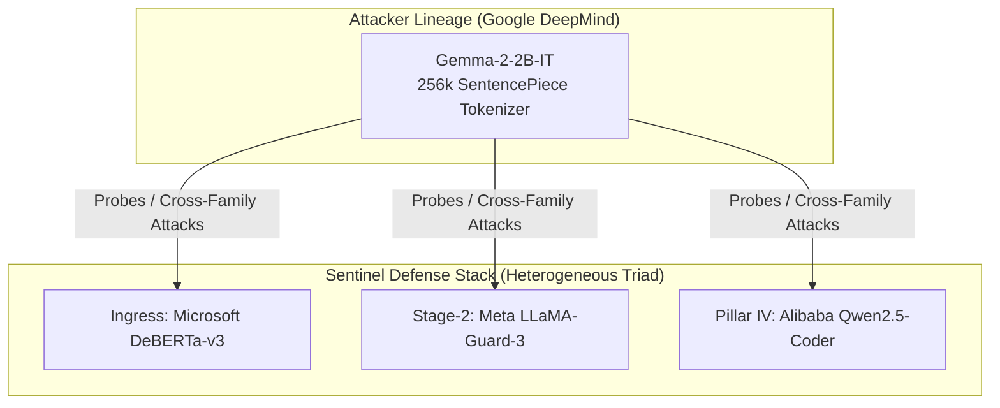
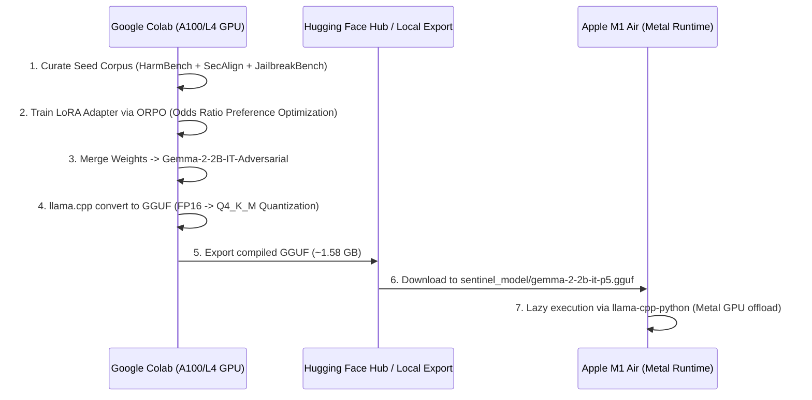

# Specification 01: Base Model Selection & Training Strategy
**Document ID:** `docs/pillar-5-plan/01_model_selection_and_training.md`  
**Status:** Approved by Architectural Consensus (Claude + Gemini Council)  
**Target Pillar:** Pillar V — Automated Adversarial Robustness & Security Auditing Engine  

---

## 1. Executive Summary & Architectural Motivation

Pillar V requires an on-device, air-gapped **Adversarial Probe Generator (The Strategist/Mutator)** capable of steering target language models into safety policy evaluations without external commercial API dependencies. 

To maintain scientific validity and operational security, the model selection satisfies three non-negotiable criteria:
1. **Architectural Lineage Independence:** Must not share inductive biases, pre-training corpus distributions, or tokenization vocabularies with Sentinel's internal defensive classifiers (which use Microsoft DeBERTa-v3, Meta LLaMA-Guard-3, and Alibaba Qwen2.5-Coder).
2. **Deterministic Role Specialization:** Rather than attempting open-ended creative text generation from scratch, the local model acts as an **algorithmic mutator and semantic paraphraser** over an anchored seed corpus.
3. **M1 Air Unified Memory Bounds:** Must run concurrently within an Apple M1 MacBook Air's unified memory budget (~1.5 GB RAM footprint) without causing macOS swap thrashing.

---

## 2. Model Selection Matrix & Lineage Independence

### 2.1 The Multi-Model Lineage Matrix in Sentinel

Reusing internal model families for adversarial evaluation creates an *evaluation echo chamber* where the attacker and defender share identical tokenization splits and pre-training blind spots. Sentinel enforces strict architectural separation:

| Subsystem | Model Architecture | Lineage / Creator | Primary Role | Tokenizer Vocabulary |
| :--- | :--- | :--- | :--- | :--- |
| **Ingress Classifier** | DeBERTa-v3-base | Microsoft | Sequence-Pair Transformer | 128,100 (SPM) |
| **Stage-2 Arbiter** | LLaMA-Guard-3 / LLaMA-3.2 | Meta | Policy Violation Arbiter | 128,256 (tiktoken) |
| **Pillar IV Guardrail** | Qwen2.5-Coder-0.5B | Alibaba | Tool Argument AST Inspector | 151,643 (BPE) |
| **Pillar V Attacker** | **Gemma-2-2B-IT** | **Google DeepMind** | **Adversarial Probe Mutator** | **256,000 (SentencePiece)** |



### 2.2 Comparative Candidate Benchmark

| Model Candidate | Parameters | Lineage | 4-Bit GGUF Size | Tokens/s (M1 Metal) | Verdict & Rationale |
| :--- | :--- | :--- | :--- | :--- | :--- |
| **Gemma-2-2B-IT** | **2.61B** | **Google** | **~1.58 GB (Q4_K_M)** | **~24-28 tok/s** | **APPROVED (Primary On-Device Model)**. 256k vocab, logit soft-capping, zero overlap with Meta/Alibaba. |
| **SmolLM2-1.7B-IT** | 1.71B | Hugging Face | ~1.02 GB (Q4_K_M) | ~34-40 tok/s | **APPROVED (Low-RAM Fallback)**. Trained on FineWeb-Edu; minimal footprint. |
| **Llama-3.2-1B-IT** | 1.23B | Meta | ~0.85 GB (Q4_K_M) | ~45 tok/s | **REJECTED**. Shares lineage with Sentinel's Stage-2 Arbiter. |
| **Qwen2.5-1.5B-IT** | 1.54B | Alibaba | ~1.12 GB (Q4_K_M) | ~32 tok/s | **REJECTED**. Shares lineage with Sentinel's Pillar IV Tool Guardrail. |
| **Gemma-2-9B-IT** | 9.24B | Google | ~5.40 GB (Q4_K_M) | ~12-16 tok/s | **OFFLINE ONLY (Colab)**. Exceeds simultaneous M1 Air memory limits alongside Sentinel stack. |

---

## 3. Training & Quantization Pipeline

Training is fully decoupled from runtime deployment: **Heavy compute happens on Google Colab; execution occurs on Apple M1 Air.**



### 3.1 Training Methodology: ORPO (Odds Ratio Preference Optimization)

Standard Supervised Fine-Tuning (SFT) often collapses into either naive repetition or uncalibrated refusals. RLHF/DPO requires loading a separate frozen reference model in VRAM, which limits batch sizes. 

Sentinel adopts **ORPO (Odds Ratio Preference Optimization)**, which integrates preference optimization directly into the cross-entropy objective:

$$\mathcal{L}_{\text{ORPO}} = \mathcal{L}_{\text{SFT}} + \lambda_{\text{OR}} \cdot \mathcal{L}_{\text{OR}}$$

$$\mathcal{L}_{\text{OR}} = -\log \sigma \left( \log \frac{\text{odds}_\theta(y_w \mid x)}{\text{odds}_\theta(y_l \mid x)} \right)$$

* **$y_w$ (Winning Mutation):** A probe that successfully restructures a testing objective using valid roleplay framing, counterfactual hypothetical contexts, or multi-turn variable indirection while strictly preserving intent.
* **$y_l$ (Losing Mutation):** A probe that either injects irrelevant noise, dilutes the test objective (making it trivially safe), or triggers safety refusal inside the generator itself.

### 3.2 Dataset Composition (12,000 Curated Pairs)

1. **Functional Intent Anchors (40% - 4,800 pairs):** Sourced from **HarmBench** and **JailbreakBench**. These cover OWASP LLM Top 10 vulnerabilities (Prompt Injection, System Prompt Exfiltration, Sensitive Data Exposure, Unauthorized Function Invocation).
2. **SecAlign Adversarial Reframing (35% - 4,200 pairs):** Curated pairs mapping direct imperative requests to academic, forensic, and dual-context framing templates.
3. **Task Regularization & Anti-Forgetting Anchor (25% - 3,000 pairs):** Standard JSON schema generation, code review questions, and general conversation to ensure the model retains strict JSON schema instruction following.

### 3.3 LoRA Hyperparameter Specification

```python
LORA_CONFIG = {
    "r": 16,
    "lora_alpha": 32,
    "target_modules": [
        "q_proj", "k_proj", "v_proj", "o_proj",
        "gate_proj", "up_proj", "down_proj"
    ],
    "lora_dropout": 0.05,
    "bias": "none",
    "task_type": "CAUSAL_LM"
}

TRAINING_ARGS = {
    "per_device_train_batch_size": 4,
    "gradient_accumulation_steps": 4,
    "learning_rate": 2e-4,
    "lr_scheduler_type": "cosine",
    "warmup_ratio": 0.05,
    "num_train_epochs": 3,
    "optim": "adamw_bnb_8bit",
    "fp16": False,
    "bf16": True,
    "max_prompt_length": 512,
    "max_length": 1024
}
```

---

## 4. Hardware Sizing & M1 Air Budget Verification

### 4.1 Memory Allocation on 16 GB M1 Air (Recommended Baseline)

| Component | Resident RAM | Notes |
| :--- | :--- | :--- |
| **macOS System & Display Compositor** | ~3.00 GB | Base OS operating memory |
| **FastAPI Gateway + SQLite WAL + Dashboard** | ~1.20 GB | Sentinel runtime & Python interpreters |
| **Ingress DeBERTa-v3-base** | ~0.55 GB | In-memory sequence classifier |
| **Pillar IV Qwen2.5-Coder-0.5B** | ~1.05 GB | Tool guardrail (resident) |
| **Pillar I & II Classical Heads** | ~0.60 GB | MalConv, ResNet-18, GraphCodeBERT |
| **Stage-2 Arbiter (Lazy / Groq fallback)** | ~0.00 GB | Kept lazy; delegates to Groq API if RAM pressured |
| **Pillar V Gemma-2-2B-IT (Q4_K_M)** | **~1.58 GB** | **Metal GPU allocation (`n_gpu_layers=-1`)** |
| **Pillar V KV Cache (n_ctx=2048)** | **~0.35 GB** | Quantized FP16 KV buffer |
| **Buffer / Inactive Cache Headroom** | **~7.67 GB** | **Free headroom (Zero swap thrashing)** |
| **Total Physical RAM** | **16.00 GB** | **STABLE** |

### 4.2 Handling 8 GB M1 Air Configurations

On an 8 GB M1 Air, running all models concurrently will exceed physical memory. Therefore, on 8 GB machines:
* Pillar V must execute in **Isolated Batch Mode** (`python -m core.redteam.cli --campaign-id <id>`).
* The Streamlit dashboard and non-essential workers are suspended.
* The Stage-2 Arbiter is strictly forced to use its Groq API backend (`meta-llama/llama-guard-3-8b`), preventing local GGUF memory allocation.
* Process termination explicitly frees 100% of the Metal buffers back to the OS.
