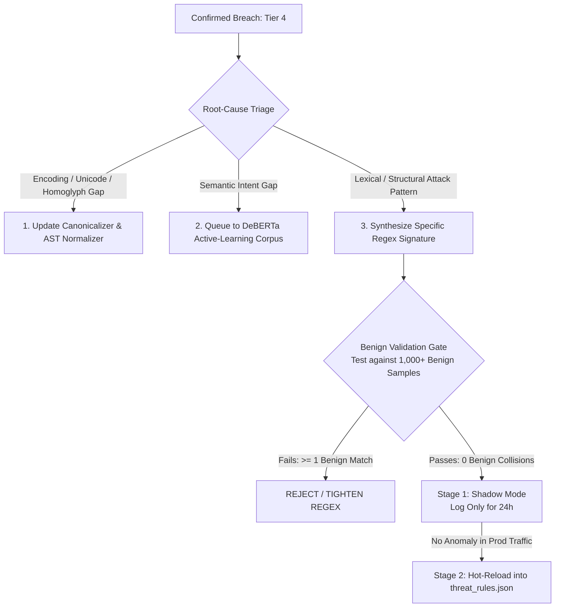

# Specification 04: Closed-Loop Auto-Immunization & False Positive Control
**Document ID:** `docs/pillar-5-plan/04_closed_loop_auto_immunization.md`  
**Status:** Approved by Architectural Consensus (Claude + Gemini Council)  
**Target Pillar:** Pillar V — Automated Adversarial Robustness & Security Auditing Engine  

---

## 1. Architectural Motivation & The Auto-Hardening Problem

When an adversarial audit discovers a prompt that bypasses Sentinel's ingress defenses (Tier 4 `VIOLATION_CONFIRMED`), the gateway must **self-harden automatically**. 

However, naively converting winning prompts into static regex signatures creates two severe operational hazards:
1. **False Positive Storms:** Overly broad regexes block legitimate developers discussing security concepts, writing SQL queries, or quoting error logs.
2. **ReDoS (Regular Expression Denial of Service):** Poorly synthesized nested quantifiers (`r"(.*a+)+"` ) allow attackers to freeze the gateway with polynomial CPU spikes.
3. **Overfitting to Surface Scaffolding:** Writing a rule against the attacker's persona framing (*"You are an academic researcher in 1995..."*) fails to block the actual underlying exploit primitive.

To solve this, Sentinel establishes a **Root-Cause Triage Engine** and a **Staged Shadow-Mode Validation Pipeline**.



---

## 2. Root-Cause Triage Matrix (Before Regex Generation)

Before generating any regex signature, Sentinel classifies *why* the attack succeeded:

| Triage Category | Root Cause | Primary Remediation | Secondary Remediation |
| :--- | :--- | :--- | :--- |
| **Type A: Normalization Gap** | Zero-width spaces, Base64 wraps, Cyrillic homoglyphs bypassed tokenizer. | **Patch Ingress Normalizer** ([`ast_normalizer.py`](file:///home/utkarsh/Desktop/sentinel/sentinel/core/detection/guardrails/ast_normalizer.py)). | Strip homoglyphs at gateway entry. |
| **Type B: Semantic Gap** | Complex framing tricked DeBERTa-v3 sequence classification head. | **Active Learning Queue** for next Colab training run. | Adjust Stage-2 Arbiter escalation threshold. |
| **Type C: Lexical Gap** | Specific invariant exploit phrase bypassed Pattern Hunter. | **Synthesize Targeted Regex** for [`threat_rules.json`](file:///home/utkarsh/Desktop/sentinel/sentinel/core/detection/threat_rules.json). | Set initial severity to `MEDIUM` (weight: 35). |

---

## 3. False-Positive Bounding & Statistical Verification

Claude's consultation highlighted a foundational mathematical truth: **You cannot promise a 0.0% False Positive Rate without infinite data.** 

Under the **Rule of Three**, if a candidate regex triggers zero false positives across $N$ independent benign validation samples, the 95% confidence upper bound on its true false positive rate is:

$$\text{FPR}_{95\%} \le \frac{3}{N}$$

* With $N = 300$ benign samples: $\text{FPR} \le 1.0\%$
* With $N = 3,000$ benign samples: $\text{FPR} \le 0.1\%$
* With $N = 30,000$ benign samples: $\text{FPR} \le 0.01\%$

### 3.1 The Benign Validation Gate (Pre-Flight Filter)

Before any synthesized rule touches `threat_rules.json`, it must pass through an automated pre-flight test against a local benchmark of **1,500 hard-negative benign enterprise queries**:
* 500 standard software engineering queries (SQL tutorials, bash syntax, Git instructions).
* 500 academic cybersecurity discussions (quoting CVE names, discussing buffer overflows conceptually).
* 500 multi-lingual customer support and general domain interactions.

```python
class BenignValidationGate:
    def __init__(self, benchmark_corpus_path: str = "core/redteam/data/benign_corpus.json"):
        with open(benchmark_corpus_path, "r", encoding="utf-8") as f:
            self.benign_samples: List[str] = json.load(f)["samples"]

    def validate_candidate_regex(self, pattern: str) -> Tuple[bool, float, List[str]]:
        """
        Tests candidate regex against benign corpus.
        Returns: (passes_gate, false_positive_rate, colliding_samples)
        """
        compiled = re.compile(pattern, re.IGNORECASE)
        collisions = []
        for sample in self.benign_samples:
            if compiled.search(sample):
                collisions.append(sample[:80])

        n = len(self.benign_samples)
        fpr = len(collisions) / n if n > 0 else 1.0

        # Strict Zero-Collision Rule on local validation corpus
        passes = (len(collisions) == 0)
        return passes, fpr, collisions
```

---

## 4. ReDoS-Safe Regex Synthesis Specification

To eliminate catastrophic backtracking, all synthesized regular expressions must conform to strict structural rules:
1. **Atomic Word Boundaries:** Patterns must anchor on word boundaries `\b`.
2. **Bounded Non-Greedy Spacing:** Disallow unbounded nested quantifiers (`.*`). Allow only bounded whitespace and filler words: `r"\s+(?:\w+\s+){0,3}?"`.
3. **Compile-Time ReDoS Testing:** Execute a synthetic timeout test against pathological strings (`"a" * 1000 + "!"`) with a 50ms execution cap.

### 4.1 Integration into Existing `ThreatIntelligenceFeed`

The synthesis pipeline bridges directly into Sentinel's existing [`threat_feed.py`](file:///home/utkarsh/Desktop/sentinel/sentinel/core/security_vectors/threat_feed.py):

```python
def synthesize_safe_rule(
    cluster_phrases: List[str],
    category: str,
    campaign_id: str
) -> Optional[Dict[str, Any]]:
    """
    Synthesizes a production-grade signature from clustered attack phrases
    and validates it against the Benign Corpus.
    """
    clean_words = []
    for p in cluster_phrases:
        clean_words.extend([re.escape(w) for w in p.strip().split() if len(w) > 3])

    if len(clean_words) < 2:
        return None

    # Construct bounded, ReDoS-safe pattern
    pattern = r"(?i)\b" + r"\s+(?:\w+\s+){0,2}?".join(clean_words[:4]) + r"\b"

    # Pre-Flight Benign Gate
    gate = BenignValidationGate()
    passes, fpr, collisions = gate.validate_candidate_regex(pattern)

    if not passes:
        logger.warning(f"[Self-Hardening] Rejected rule '{pattern}' due to {len(collisions)} benign collisions.")
        return None

    rule_id = f"AUTO-P5-{uuid.uuid4().hex[:6].upper()}"
    return {
        "id": rule_id,
        "name": f"Pillar-V Hardened: {' '.join(clean_words[:3])}",
        "pattern": pattern,
        "severity": "HIGH",
        "weight": 40,
        "mode": "SHADOW",  # Staged rollout
        "source": "pillar_v_closed_loop",
        "campaign_id": campaign_id,
        "created_at": datetime.now(timezone.utc).isoformat(),
        "promoted_at": None
    }
```

---

## 5. Staged Deployment Pipeline (Shadow Mode $\to$ Enforce Mode)

Newly synthesized rules follow a two-stage rollout to protect production traffic:

1. **Stage 1: Shadow Mode (24-Hour Evaluation Window):**
   * The rule is written to `threat_rules.json` with `"mode": "SHADOW"`.
   * When matching live ingress traffic, Sentinel **logs the detection** to `gateway.db` in `security_events`, but **does NOT block the request**.
   * If the rule matches zero false alarms over 24 hours (or after 500 clean user requests), it is eligible for promotion.
2. **Stage 2: Enforce Mode (Active Ingress Blocking):**
   * The rule mode is updated to `"mode": "ENFORCE"`.
   * It contributes its full assigned weight (35–40) to Sentinel's `WeightedConsensusJudge`, blocking future evasions at the gateway boundary.
   * A one-click *"Revert Rule"* action is exposed in Tab 4 and Tab 9 of the SOC Dashboard for immediate operator rollback.
