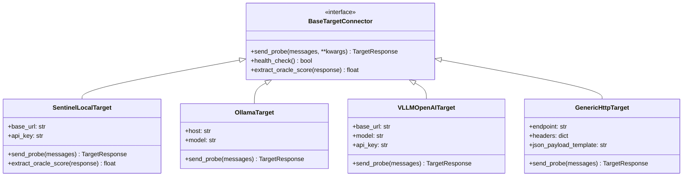

# Specification 05: Target Integration, API Endpoints & SOC Dashboard
**Document ID:** `docs/pillar-5-plan/05_target_integration_and_api.md`  
**Status:** Approved by Architectural Consensus (Claude + Gemini Council)  
**Target Pillar:** Pillar V — Automated Adversarial Robustness & Security Auditing Engine  

---

## 1. Universal Target Connector Architecture

Pillar V operates in dual target modes:
1. **Mode A (External Model Audit):** Benchmarking third-party models (local Ollama instances, vLLM servers, or enterprise HTTP endpoints) to generate standardized OWASP LLM Top 10 compliance scorecards.
2. **Mode B (Sentinel Self-Hardening Closed Loop):** Auditing Sentinel’s own local ingress gateway, using its continuous consensus score as a hill-climbing oracle and auto-synthesizing defensive rules upon confirmed breach.



### 1.1 The Sentinel Local Oracle Advantage

When auditing Sentinel itself, the gateway exposes internal inspection telemetry:
* `decision`: `"ALLOW"` vs. `"BLOCK"`
* `consensus_score`: Continuous risk score $\in [0.0, 1.0]$
* `breakdown`: Component sub-scores (`pattern_score`, `semantic_score`, `behavioral_score`)

This eliminates the need for an external LLM judge during self-audits. The TAP-Lite search engine uses Sentinel's own continuous risk score directly as the objective function to minimize (hill-climbing until a prompt drops the risk score below the blocking threshold).

---

## 2. Operational Safety & Target Scoping Guardrails

Because Pillar V executes automated adversarial perturbations, it enforces strict operational constraints to prevent unintended abuse:
1. **Target Allow-List Enforcement:** The engine refuses to dispatch probes to arbitrary public IP addresses. Allowed destinations are restricted to:
   * Local loopback: `127.0.0.1`, `localhost`, `::1`
   * Configured corporate intranet subnets (RFC-1918) explicitly declared in `.env` under `REDTEAM_ALLOWED_HOSTS`.
2. **Rate Limiting & Concurrency Caps:** Outbound probe dispatching is limited to a maximum of 2 requests per second to avoid triggering external rate-limits or exhausting local compute.
3. **Canary Encapsulation:** All exfiltration probes utilize synthetic honeytokens generated at runtime; no production secrets or real PII are ever included in probe payloads.

---

## 3. Database Schema Extensions (`gateway.db`)

To ensure persistence, thermal-pause resume capability, and real-time dashboard telemetry, two tables are added to Sentinel's SQLite WAL database:

```sql
-- Audit Campaign Master Table
CREATE TABLE IF NOT EXISTS redteam_campaigns (
    campaign_id TEXT PRIMARY KEY,
    target_type TEXT NOT NULL,
    target_endpoint TEXT NOT NULL,
    target_model TEXT,
    status TEXT NOT NULL,           -- 'QUEUED', 'RUNNING', 'COMPLETED', 'FAILED', 'PAUSED'
    total_seeds INTEGER NOT NULL,
    total_nodes_evaluated INTEGER DEFAULT 0,
    breaches_detected INTEGER DEFAULT 0,
    rules_synthesized INTEGER DEFAULT 0,
    created_at TEXT NOT NULL,
    completed_at TEXT
);

-- Search Tree Nodes (Audit Telemetry)
CREATE TABLE IF NOT EXISTS redteam_nodes (
    node_id TEXT PRIMARY KEY,
    campaign_id TEXT NOT NULL,
    parent_id TEXT,
    depth INTEGER NOT NULL,
    mutation_type TEXT NOT NULL,    -- 'DETERMINISTIC_SPLIT', 'ROLEPLAY_PERSONA', 'BASE64_WRAP'
    prompt_text TEXT NOT NULL,
    response_text TEXT,
    target_score REAL NOT NULL,     -- Risk score returned by target or judge
    intent_similarity REAL NOT NULL,-- Cosine similarity to root seed
    verdict TEXT NOT NULL,          -- 'REFUSED', 'EVASIVE_NEUTRAL', 'COMPLIED_BENIGN', 'VIOLATION_CONFIRMED'
    oracle_hit TEXT,                -- 'CANARY_LEAK', 'TOOL_SSRF', 'ROUGE_LEAK', 'NONE'
    created_at TEXT NOT NULL,
    FOREIGN KEY(campaign_id) REFERENCES redteam_campaigns(campaign_id)
);
```

---

## 4. FastAPI Gateway REST Endpoints (`sentinel/core/gateway/app.py`)

```python
# ── Pillar V: Automated Adversarial Robustness Engine Endpoints ───────────────

@app.post("/api/v1/redteam/audit/start", tags=["Pillar V"])
async def start_audit_campaign(req: StartAuditRequest, background_tasks: BackgroundTasks):
    """
    Launches an autonomous adversarial audit campaign in an isolated OS subprocess.
    """
    # 1. Enforce Target Allow-List
    if not is_host_allowed(req.target_endpoint):
        raise HTTPException(status_code=403, detail="Target host not in REDTEAM_ALLOWED_HOSTS allowlist")

    campaign_id = f"cmp-{uuid.uuid4().hex[:8]}"
    
    # 2. Spawn Isolated Subprocess (Protects FastAPI and guarantees Metal memory reclamation)
    cmd = [
        sys.executable, "-m", "core.redteam.runner",
        "--campaign-id", campaign_id,
        "--target-type", req.target_type,
        "--target-endpoint", req.target_endpoint,
        "--max-depth", str(req.max_turns),
        "--beam-width", str(req.branching_factor)
    ]
    subprocess.Popen(cmd, close_fds=True)

    return {
        "status": "QUEUED",
        "campaign_id": campaign_id,
        "target": req.target_endpoint,
        "message": "Audit campaign spawned in isolated subprocess."
    }

@app.get("/api/v1/redteam/audit/status/{campaign_id}", tags=["Pillar V"])
async def get_audit_status(campaign_id: str):
    """Polls real-time progress, active tree depth, and breach counts from SQLite WAL."""
    campaign = db.fetch_campaign(campaign_id)
    if not campaign:
        raise HTTPException(status_code=404, detail="Campaign not found")
    return campaign

@app.get("/api/v1/redteam/audit/report/{campaign_id}", tags=["Pillar V"])
async def get_audit_report(campaign_id: str):
    """Returns complete compliance scorecard, OWASP radar breakdown, and attack traces."""
    report = db.fetch_campaign_report(campaign_id)
    if not report:
        raise HTTPException(status_code=404, detail="Report not generated")
    return report

@app.post("/api/v1/redteam/rules/promote/{rule_id}", tags=["Pillar V"])
async def promote_rule_to_enforce(rule_id: str):
    """Promotes a shadow-mode rule to active ingress blocking mode."""
    success = db.promote_threat_rule(rule_id)
    return {"success": success, "rule_id": rule_id, "new_mode": "ENFORCE"}
```

---

## 5. SOC Dashboard Layout (Tab 9: `sentinel/dashboard/app.py`)

In `sentinel/dashboard/app.py`, Tab 9 is added to the interface:

```
Tab 9: 🎯 Adversarial Robustness & Security Auditing (Pillar V)
├── Section 1: Campaign Configuration Bar
│   ├── Target Selector (Sentinel Local Gateway / Ollama / Custom HTTP)
│   ├── Threat Category Multiselect (Injection, Honeytokens, Tool Hijacking)
│   ├── Search Parameters (Beam Width: 3, Max Depth: 4)
│   └── Action: [▶ Start Audit Campaign]
├── Section 2: Real-Time Live Execution Telemetry
│   ├── Metric Cards: Active Depth, Nodes Evaluated, Breaches Detected, Memory Pressure
│   └── Tree-of-Attacks Visualizer (Interactive Graph showing pruned vs active nodes)
├── Section 3: OWASP Compliance Scorecard
│   ├── Plotly Spider/Radar Chart (Defensive Resilience across OWASP LLM Top 10)
│   └── Vulnerability Trace Table (Inspecting winning prompts & model responses)
└── Section 4: Closed-Loop Auto-Immunization Panel
    ├── Live Rules Feed (Auto-synthesized signatures in SHADOW vs ENFORCE mode)
    └── Action: [⚡ Verify Immune Response] (Replays winning probe to confirm block)
```
