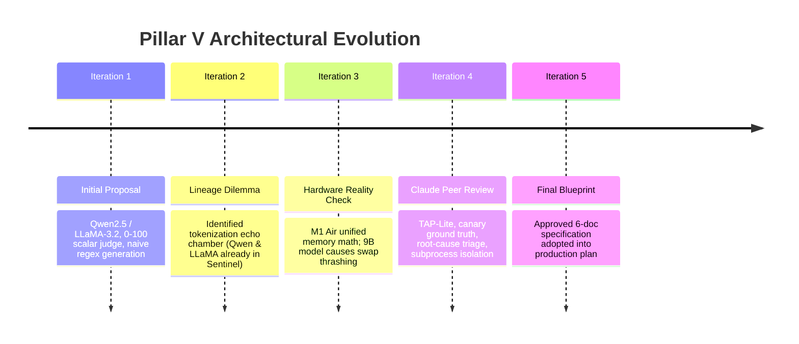

# Specification 06: Architectural Deliberations & Consensus Log
**Document ID:** `docs/pillar-5-plan/06_consensus_log.md`  
**Status:** Final Consensus Reached (Principal Architect, Claude Consultant, and Engineering Lead)  
**Target Pillar:** Pillar V — Automated Adversarial Robustness & Security Auditing Engine  

---

## 1. Executive Summary & Purpose

This document serves as the permanent chronological record of architectural debates, comparative evaluations, and consensus decisions for **Pillar V (Automated Adversarial Robustness & Security Auditing Engine)** of the Sentinel AI Security Gateway (v2.0).

---

## 2. Chronological Record of Architectural Iterations

### Iteration 1: Initial Baseline Proposal
* **Proposed Design:** Use a compact local model (Qwen2.5-Coder-0.5B/1.5B or LLaMA-3.2-1B) to generate adversarial prompts; evaluate targets using a continuous 0–100 scalar; immediately synthesize regex signatures upon score $\ge 85$.
* **Critique & Flaws Identified:**
  1. *Lineage Overlap:* Sentinel already uses Qwen2.5-Coder in Pillar IV and LLaMA in Stage-2.
  2. *False Precision:* A single continuous 0–100 score invites gaming and hallucination.
  3. *Unbounded False Positives:* Naive regex generation from single prompts will block legitimate user traffic.

### Iteration 2: The Model Lineage Dilemma & Shared Inductive Bias
* **Core Insight:** In adversarial security, using the same model family for both the attacker and the defense components creates an **evaluation echo chamber**. The attacker’s mutations are constrained by the same Byte-Pair Encoding (BPE) boundaries and pre-training blind spots as the defender.
* **Consensus Resolution:** Enforce strict **tri-partite lineage independence**:
  * Ingress Defender: Microsoft (DeBERTa-v3)
  * Gray-Zone Arbiter: Meta (LLaMA-Guard-3 / LLaMA-3.2)
  * Agentic Tool Guardrail: Alibaba (Qwen2.5-Coder)
  * **Pillar V Attacker:** **Google DeepMind (Gemma-2-2B-IT)** with a completely separate 256k SentencePiece tokenizer.

### Iteration 3: Hardware Reality Check (M1 Air Unified Memory)
* **The Question:** If training occurs on Google Colab GPUs, can we deploy a 7B–9B model (like Gemma-2-9B or Mistral-7B) on an M1 MacBook Air?
* **Memory Math Breakdown:**
  * Baseline macOS + display + FastAPI + Streamlit = ~4.2 GB
  * Baseline Sentinel Stack (DeBERTa + Qwen-0.5B + GraphCodeBERT + MalConv) = ~3.6 GB
  * Total Baseline before Pillar V = **~7.8 GB**
  * Adding a 9B GGUF model (~5.5 GB) brings total memory to **~13.3 GB**.
* **Consensus Resolution:** On an **8 GB M1 Air**, running a 9B model causes instant kernel panic or extreme SSD swap thrashing. On a **16 GB M1 Air**, it leaves minimal headroom. **Google Gemma-2-2B-IT (Q4_K_M GGUF @ ~1.58 GB)** was confirmed as the optimal on-device choice, providing independent lineage, fast Metal GPU execution (~25 tok/s), and zero swap contention.

### Iteration 4: Peer Review via Claude (`ai-helper`)
A full technical consultation was conducted with Claude via the local `ai-helper` bridge. Claude's formal verdict introduced four foundational improvements adopted directly into the final architecture:
1. **Canary Engine as Objective Ground Truth:** Rather than relying on an LLM judge to guess whether a response is compliant, embed instructions that force a compliant model to emit a unique honeytoken or invoke a sandboxed tool. A hit is **100% authoritative**.
2. **True Definition of Evasion:** Evasion cannot mean simply "got past Sentinel." True success must strictly require:  
   $$\text{Success} \iff (\text{Not Blocked by Sentinel}) \land (\text{Adversarial Intent Preserved})$$
3. **TAP-Lite Search:** Replace expensive LLM-based off-topic pruning with fast embedding cosine similarity to the seed intent.
4. **Subprocess Isolation on macOS:** Run the audit campaign as an isolated OS process. Process exit is the only reliable mechanism to guarantee that macOS releases 100% of Apple Metal GPU memory buffers.
5. **Root-Cause Triage Before Regex:** Triage failures into Normalization gaps (fix canonicalizer), Semantic gaps (retrain DeBERTa), and Lexical gaps (synthesize regex). Staging newly synthesized rules in **Shadow Mode** protects production uptime.

---

## 3. Final Approved Architectural Specifications

The resulting multi-pillar defense and red-teaming topology is finalized as follows:

| Pillar | Subsystem | Model / Core Engine | Lineage | Runtime Device |
| :---: | :--- | :--- | :--- | :--- |
| **Ingress** | Pattern Hunter & Semantic Analyst | DeBERTa-v3-base | Microsoft | CPU / MPS |
| **Ingress** | Stage-2 Gray-Zone Arbiter | LLaMA-Guard-3 / LLaMA-3.2 | Meta | Groq API / Local GGUF |
| **Vector** | Threat Intelligence Feed | TF-IDF n-gram Clustering | Scikit-Learn | Local CPU |
| **Vector** | Canary Engine | Honeytoken Injection & Detection | Deterministic | In-Memory |
| **Pillar I** | Binary Malware Analysis | MalConv (1D-CNN) + MalImg (ResNet) | Custom PyTorch | Local CPU |
| **Pillar II** | Code Security & AST Scanner | Python AST + GraphCodeBERT | Microsoft | Local CPU |
| **Pillar IV** | Agentic Runtime Tool Guardrail | Qwen2.5-Coder-0.5B LoRA | Alibaba | Local CPU / MPS |
| **Pillar V** | **Adversarial Probe Generator** | **Gemma-2-2B-IT (ORPO LoRA)** | **Google** | **Apple Metal GPU** |
| **Pillar V** | **Orchestrator & Search Engine** | **TAP-Lite (Beam W=3, Depth D=4)** | **Hybrid** | **Subprocess** |
| **Pillar V** | **Evaluative Judge** | **Canary Oracle + DeBERTa-v3** | **Hybrid** | **In-Memory** |

---

## 4. Implementation Roadmap & Milestones

* [x] **Milestone 1:** Architectural consultation and final specification consensus (`docs/pillar-5-plan/`).
* [ ] **Milestone 2:** Dataset curation on Google Colab (HarmBench + SecAlign + JailbreakBench) and ORPO LoRA training of `Gemma-2-2B-IT`.
* [ ] **Milestone 3:** GGUF export, quantization to `Q4_K_M`, and staging in `sentinel/sentinel_model/`.
* [ ] **Milestone 4:** Implementation of `core/redteam/` package (mutators, TAP-Lite search engine, target connectors, and subprocess runner).
* [ ] **Milestone 5:** Closed-loop self-hardening bridge to `threat_feed.py` with pre-flight Benign Validation Gate.
* [ ] **Milestone 6:** Mounting FastAPI endpoints (`/api/v1/redteam/...`) and building SOC Dashboard Tab 9.
* [ ] **Milestone 7:** End-to-end integration testing and regression validation (114/114 pytest baseline preserved).
