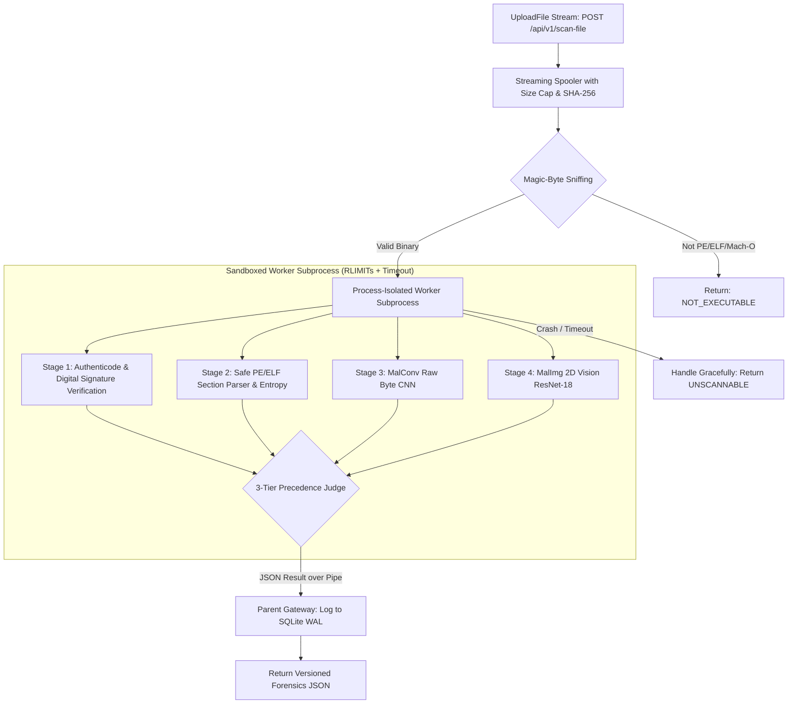

# Pillar I Study Guide — Malware Binary Analysis & Visual Malware Detection

## 1. Executive Summary & Objective

**Pillar I (Malware Binary Analysis)** provides static, non-executing malware detection and malware family attribution for executable files (PE, ELF, Mach-O) submitted to the Sentinel AI Security Gateway (`POST /api/v1/scan-file`).

Traditional security gateways face a fundamental dilemma when inspecting file uploads:
- **Antivirus Signatures (YARA/ClamAV):** Fast (<10ms), but completely blind to zero-day polymorphic malware or freshly recompiled payloads with changed hashes.
- **Dynamic Sandboxing (Cuckoo/Any.Run):** Runs the binary in a virtual machine and observes behavior. While thorough, it takes **2 to 5 minutes** per file, consumes gigabytes of memory, and is readily evaded by malware with sleep timers, sandbox-detection checks, or human-interaction requirements.

**Pillar I solves this dilemma** by combining **Static Structural Heuristics**, **Deep Raw-Byte Convolutional Neural Networks (MalConv)**, and **Computer Vision Texture Classification (MalImg ResNet-18)** into an enterprise-hardened, sub-second inspection pipeline.

---

## 2. Enterprise Architectural Blueprint & Isolation Flow

In production enterprise gateways (VirusTotal, CrowdStrike, Palo Alto WildFire), untrusted binaries can exploit the parser itself (segfaults in native C/C++ parsers, memory blowups in crafted PE headers). Therefore, Sentinel enforces a **strict process-isolated scanning model**:



---

## 3. Deep-Dive: Why These Features, Models & Algorithms Were Chosen

### A. Model A: MalConv (Gated 1D Raw Byte Sequence CNN)

| Component | Specification | Why It Was Chosen Over Alternatives |
| :--- | :--- | :--- |
| **Input Representation** | Raw integer bytes ($0 \dots 255$) | Does **not** require disassembling the binary into x86/ARM assembly. Disassemblers fail when binaries use anti-disassembly tricks, packed sections, or encrypted code. |
| **Embedding Layer** | `nn.Embedding(257, 8, padding_idx=0)` | Maps each byte value to an 8-dimensional continuous vector space. An 8-dim embedding balances expressive semantic capacity with minimal RAM consumption. Index 0 is reserved for padding tokens (shifting bytes by $+1$). |
| **Convolutional Kernel** | Kernel Size = 500, Stride = 500 | Standard small kernels ($k=3$ or $k=5$) operate at the machine-instruction level. A kernel size and stride of 500 spans entire structural PE header blocks, import tables, and functional blocks, capturing architectural macro-patterns across 2MB in only ~4,194 feature steps. |
| **Gated Convolution** | $h = \text{Conv}(x) \odot \sigma(\text{Gate}(x))$ | Inspired by language modeling (Gated Linear Units). The linear gate controls which byte sequence features are allowed to propagate forward, filtering out irrelevant padding and focusing on suspicious byte groupings. |
| **Pooling** | `nn.AdaptiveMaxPool1d(1)` | Scale-invariant feature aggregation. Regardless of whether the binary is 20KB or 2MB, adaptive max-pooling extracts the highest-activation malicious signal anywhere in the sequence. |

---

### B. Model B: MalImg (Visual Byte Texture Classification via ResNet-18)

#### 1. Why Convert a Binary to an Image?
When executable files are rendered as 2D grayscale images, distinct structural sections appear as visible textures:
- **Code Sections (`.text`):** Fine-grained, uniformly textured patterns of assembly instructions.
- **Data Sections (`.data`):** Coarser, repetitive blocks of global variables and strings.
- **Resource Sections (`.rsrc`):** High-density bitmaps, icons, or compressed data.
- **Zero-Padding:** Completely black blocks.

Malware variants within the same malware family (e.g., *Ramnit*, *FakeRean*, *Allaple*, *Yuner*) retain strikingly similar visual textures, even when code obfuscation changes instruction sequences. This allows computer vision models to perform **malware family attribution**.

#### 2. Preprocessing: File-Size Dependent Width Mapping
To preserve visual proportions without distorting aspect ratios, the byte array is mapped into a 2D matrix using Nataraj's empirical file-size width table:

| File Size Range | Image Width ($W$) | Justification |
| :--- | :--- | :--- |
| $< 10 \text{ KB}$ | 32 px | Prevents tall, pencil-thin single-column distortion |
| $10 \text{ KB} - 30 \text{ KB}$ | 64 px | Balances height-to-width ratio for small utilities |
| $30 \text{ KB} - 60 \text{ KB}$ | 128 px | Standard width for small DLLs |
| $60 \text{ KB} - 100 \text{ KB}$ | 256 px | Preserves PE header block layouts |
| $100 \text{ KB} - 200 \text{ KB}$ | 384 px | Retains multi-section separation |
| $200 \text{ KB} - 500 \text{ KB}$ | 512 px | High resolution for medium-sized binaries |
| $500 \text{ KB} - 1000 \text{ KB}$ | 768 px | Captures large resource and data blocks |
| $> 1000 \text{ KB}$ | 1024 px | Maximum width for large executables |

The resulting 2D matrix is bilinearly resized to $224 \times 224 \times 1$ using PyTorch's native `F.interpolate(mode='area')`, eliminating any external dependency on heavy image processing libraries (OpenCV or Pillow).

#### 3. Why ResNet-18 with 26 Classes (Including "Benign")?
- **Pretrained Feature Extraction:** ImageNet filters already know how to identify edges, gradients, and textures. Collapsing the first convolution from 3 RGB channels to 1 grayscale channel (`conv1.weight.sum(dim=1)`) preserves ImageNet weights while adapting to 1-channel grayscale inputs.
- **The "Benign" Class Correction:** A naive 25-family malware classifier *always* outputs a malware family, even for clean Windows binaries. By introducing a 26th **"Benign"** class, the model can explicitly confirm clean files without false positive attribution.

---

### C. Shannon Section Entropy: Contextual Packing Detection

#### The Formula
Shannon Entropy measures the randomness (information density) of a byte stream:
$$H = -\sum_{i=0}^{255} p_i \log_2(p_i) \quad (0 \le H \le 8 \text{ bits/byte})$$

#### Contextual Entropy Interpretation (Avoiding False Positives)
- **$H < 2.0$ (Very Low):** Sparse sections, zero-padding, plain text logs.
- **$5.5 \le H \le 6.8$ (Normal):** Standard uncompressed, compiled machine code (`.text`).
- **Contextual Rule:** High entropy ($>7.5$) in a `.rsrc` section or an installer overlay (NSIS, InnoSetup) is **normal** (compressed icons, archives). High entropy in an **executable code section (`.text`)** or an entry point residing in the last section indicates cryptographic packing (UPX, Themida), triggering an immediate security flag.

---

## 4. Enterprise Hardening & Defense-in-Depth

### A. The 3-Tier Precedence Engine (Eliminating False Positives on Vendor Binaries)
Student projects fail in production by treating all high-entropy or unrecognized files as malware. Sentinel implements enterprise tiered precedence:

```
Tier 1: High-Confidence Known-Bad (Hash Intel, Critical YARA, Revoked Cert)
        --> ALWAYS BLOCK (Overrides all other signals)
Tier 2: High-Confidence Known-Good (Valid Microsoft Authenticode / Distro Hash)
        --> SUPPRESS ML/Entropy false alarms, emit CLEAN / KNOWN_GOOD
Tier 3: Unsigned / Unverified Software
        --> Calibrated Ensemble (Heuristics 25% + MalConv 45% + MalImg 30%)
```

### B. Process Isolation & Crash Resilience
- Native parsers (`pefile`, `yara`, `torch`) can segfault or hang on crafted adversarial headers.
- The scan engine executes in a **disposable subprocess worker** with strict OS resource limits (`RLIMIT_AS`, `RLIMIT_CPU`) and a hard 8-second kill deadline (`os.killpg`).
- If an adversarial binary causes a segfault, the parent FastAPI gateway survives, captures the signal, and returns `verdict: "UNSCANNABLE" (reason: "worker_crash")`.

### C. Stream Spooling & Anti-DoS Capping
- Incoming uploads stream to a temporary disk spool in 64KB chunks.
- Memory usage is $O(1)$ regardless of file size.
- Hard file size cap: Payloads exceeding 32MB are aborted immediately with HTTP 413.
- Guaranteed cleanup: Temporary files are deleted in `try ... finally` blocks and on `CancelledError`.

---

## 5. Enterprise Verdict Taxonomy

| Verdict | Policy Action | Description |
| :--- | :--- | :--- |
| **`KNOWN_GOOD`** | `ALLOW` | Valid trusted digital signature or verified clean hash reputation |
| **`CLEAN`** | `ALLOW` | Passes all heuristic and machine learning inspection layers |
| **`SUSPICIOUS`** | `QUARANTINE` | Risk score 40–69, or anomalous section structures requiring analyst review |
| **`MALICIOUS`** | `BLOCK` | Risk score $\ge 70$, or confirmed malware family attribution |
| **`PACKED_PROTECTED`** | `ALERT` | Commercial protector or packer detected (VMProtect, Themida, UPX) |
| **`NOT_EXECUTABLE`** | `REJECT` | File is not an executable binary (rejected at magic-byte check) |
| **`UNSCANNABLE`** | `QUARANTINE` | Corrupted headers, parser segfault, or scan timeout |

---

## 6. Threat Intelligence & Forensics Output Contract

Every scan returns a structured, versioned forensic report mapping directly to industry standards:
- **Cryptographic Hashes:** SHA-256, MD5, SHA-1, Imphash, SSDEEP (fuzzy hash).
- **MITRE ATT&CK Mapping:** Inferred capabilities (e.g., `T1055` Process Injection, `T1027.002` Software Packing, `T1622` Debugger Evasion).
- **Per-Section Breakdown:** Virtual size, raw size, permissions (`r-x`, `rw-`), and Shannon entropy per section.
- **Defanged IOCs:** Extracted URLs, domains, and IPs sanitized to prevent accidental client execution.
