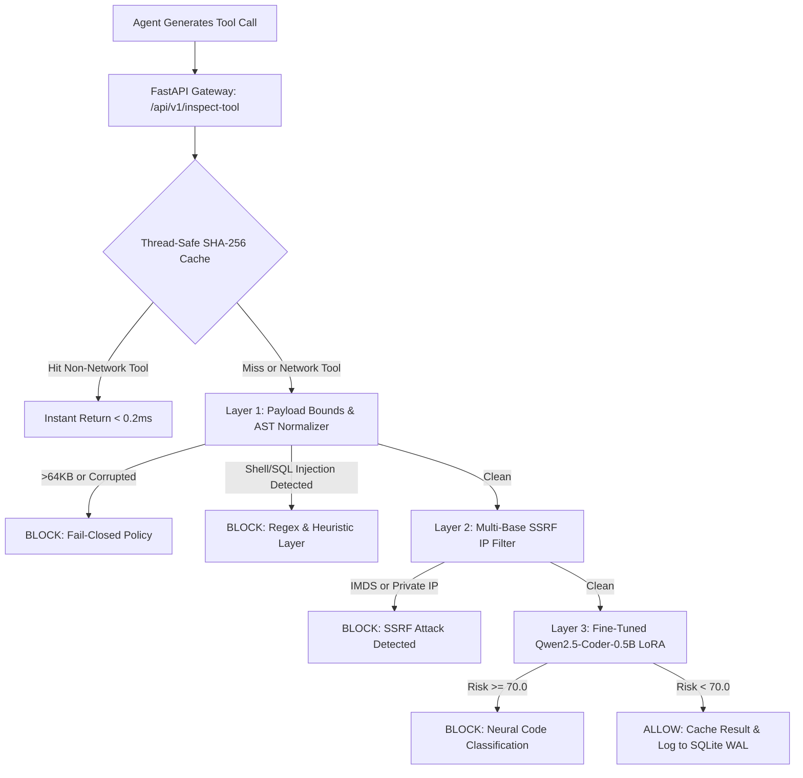

# Pillar IV Study Guide — Agentic Runtime Guardrails

## 1. Executive Summary & Objective

In modern agentic AI systems (e.g., AutoGPT, LangChain agents, CrewAI, OpenAI Assistants), autonomous LLMs are granted access to execute real-world tools: terminal shells, database query engines, filesystem APIs, and HTTP request clients. 

If an attacker manipulates the agent via prompt injection or poisoned context, the agent can be tricked into executing destructive or exfiltrating commands. **Pillar IV (Agentic Runtime Guardrails)** acts as an inline security firewall (`/api/v1/inspect-tool`). It intercepts every tool invocation **mid-flight** before execution, evaluating the payload through a deterministic parser and a code-specialized neural network.

---

## 2. Architecture & The Multi-Layer Inspection Pipeline

Pillar IV uses a multi-layered defense-in-depth pipeline. A payload must pass through all security layers before it is permitted to run:

---

## 3. Deep-Dive: Why These Models & Algorithms Were Chosen

### A. Model Choice: Qwen2.5-Coder-0.5B LoRA vs. DistilBERT vs. Regex

| Criteria | Regex Only | DistilBERT / DeBERTa | Qwen2.5-Coder-0.5B (Selected) |
| :--- | :--- | :--- | :--- |
| **Code Syntax Understanding** | ❌ None (literal pattern matching) | ⚠️ Moderate (trained on natural language text) | ✅ **State-of-the-art (pre-trained on 5.5T code tokens)** |
| **Obfuscation Robustness** | ❌ Trivial to bypass (`$@`, `\`, `$IFS`) | ⚠️ Vulnerable to syntax fragmentation | ✅ **Understands semantic equivalence of obfuscated code** |
| **Inference Latency (CPU)** | ✅ < 1 ms | ✅ ~15–30 ms | ✅ **~35–80 ms (highly acceptable for tool execution)** |
| **False Positive Rate** | ❌ High on complex bash/SQL pipelines | ⚠️ Moderate on administrative scripts | ✅ **Very low (understands context and intent)** |

#### Why Qwen2.5-Coder?
Traditional NLP transformers (BERT, RoBERTa, DistilBERT) were designed for natural language sentences. Their tokenizers split code operators (like `2>&1`, `|`, `$(...)`, or `${IFS}`) into awkward fragments, losing structural meaning. **Qwen2.5-Coder** was built specifically for code. Its tokenizer and self-attention heads retain the syntax trees and data-flow semantics of code, enabling it to distinguish between a benign administrative command (e.g., `docker-compose down && docker-compose up -d`) and an adversarial payload (e.g., `docker run -v /:/host -it ubuntu chroot /host`).

#### Why 0.5B Parameters?
Production gateways require real-time latency (<150ms). Running a 7B or 14B model on commodity CPU servers introduces multi-second delays per tool call. At 0.5B parameters, Qwen2.5-Coder provides high code comprehension while maintaining a compact memory footprint (~1.9 GB) and blazing CPU execution speeds.

---

### B. Feature Engineering & Security Defense Mechanisms

#### 1. The 64KB Fail-Closed Policy (Preventing Padding Evasions)
- **The Attack:** Attackers append 100,000 bytes of benign text, comments, or whitespace before or after a malicious command (`cat /etc/passwd`). Because transformer models have fixed context windows (or truncation bounds), standard gateways truncate the input and evaluate only the benign padding, missing the exploit.
- **The Defense:** Any payload exceeding 64KB is immediately quarantined (`BLOCK: PAYLOAD_EXCEEDS_64KB_LIMIT`). Legitimate tool arguments almost never exceed 64KB without dedicated file chunking.

#### 2. Multi-Base SSRF IP Filter (Stopping Cloud Metadata Exfiltration)
- **The Attack:** When an agent invokes HTTP fetching tools (e.g., `curl`, `fetch_url`), attackers target Cloud Instance Metadata Services (IMDS):
  - AWS/GCP IMDS: `169.254.169.254`
  - Azure WireServer: `168.63.129.16`
  - Alibaba Cloud IMDS: `100.100.100.200`
  - To evade simple string filters like `if "169.254" in url:`, attackers use alternative IP notations:
    - Decimal notation: `2852039166`
    - Hexadecimal notation: `0xa9.0xfe.0xa9.0xfe` or `0xa9fea9fe`
    - Octal notation: `0251.0376.0251.0376`
    - Mixed-base notation: `0251.254.169.254`
- **The Defense:** The `SSRFEngine` resolves all URL hostnames, unpacks mixed-base integer/hex/octal encodings into canonical IPv4/IPv6 addresses, checks against known cloud metadata endpoints, and verifies `ip.is_global` to block RFC 1918 private subnets (`10.0.0.0/8`, `172.16.0.0/12`, `192.168.0.0/16`) and loopback addresses.

#### 3. Network-Tool Cache Exclusion (Defeating DNS Rebinding)
- **The Attack:** If an agent queries `http://attacker-domain.com`, the first request resolves to an external IP (`203.0.113.5`) and is marked `BENIGN`. If cached blindly, the attacker quickly updates their DNS record (TTL = 1s) to point to `169.254.169.254`. Subsequent requests to the same URL would hit the cache and bypass inspection.
- **The Defense:** The SHA-256 LRU cache strictly excludes network tools (`curl`, `wget`, `http_request`, `fetch`). Network tools must undergo fresh DNS resolution and SSRF inspection every single time.

#### 4. Thread-Safe Mutex Lazy Loading
- **The Problem:** In high-concurrency production environments (e.g. FastAPI with Uvicorn workers), simultaneous requests arriving during cold-start can trigger multiple concurrent model loads into RAM, causing memory thrashing or crashes.
- **The Defense:** A dedicated `threading.Lock()` wraps model initialization with double-checked locking (`if self._model is None: with self._load_lock: if self._model is None: ...`), ensuring exactly one thread loads weights into memory.

---

## 4. Verification & Production Results

- **Test Suite:** Automated suite in `tests/test_tool_guardrail.py` with 21 unit and integration test cases covering:
  - Reverse shells (`/dev/tcp`, `mkfifo`, `nc`)
  - Cloud IMDS exfiltration (standard, decimal IP, hex IP, octal IP)
  - Stacked SQL injections (`pg_sleep`, `UNION SELECT`)
  - GTFOBins escapes (`find -execdir`, `env sh`)
  - Benign DevOps commands (`git status`, `docker-compose up -d`, `ls -la`)
- **Results:** 21/21 passing (100% green).
- **Latency Benchmark:**
  - Cold inference: ~80–120ms.
  - Warm inference: ~35–45ms.
  - In-memory cache hit: **0.109 ms**.
