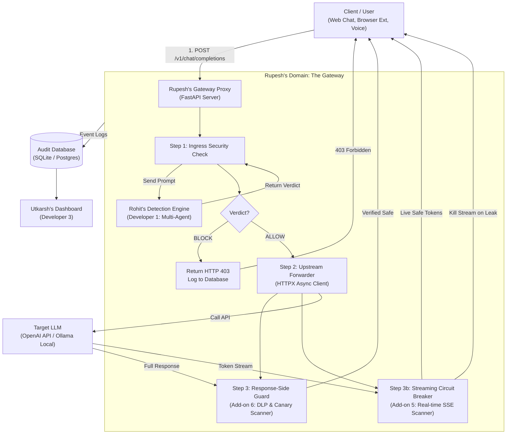
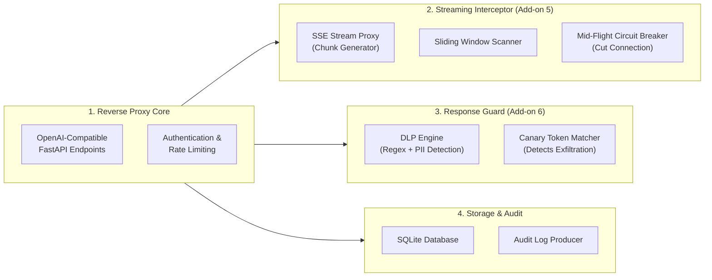
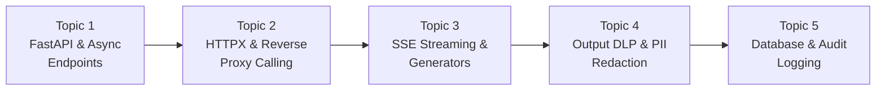

# Developer 2 (Rupesh) — Systems & Gateway Proxy Engineer
**B.Tech Minor Project (IT401) | Group 138 | Department of Information Technology, DTU**  
**Role:** Systems Architecture, Gateway Proxy & Streaming Defense Engineer  
**Supervisor:** Dr. Akshay Mool  

---

## 1. Executive Summary & Objective

In this project, our team is building an **AI Security Gateway**. The gateway acts as an independent shield placed between external users and a Large Language Model (such as GPT-4, Llama, or Claude).

### Rupesh's Core Mission
Rupesh is the **backbone and traffic controller** of the entire project. While Rohit builds the detection brain and Utkarsh builds attack vectors and the UI, Rupesh builds the high-performance server that handles all live network traffic, enforces security decisions, and protects output streams.

Rupesh's system must:
1. Provide a central API endpoint (`/v1/chat/completions`) that can plug into any existing AI application or chatbot without changing their code.
2. Route incoming prompts to Rohit's detection engine and immediately block attacks with an HTTP 403 Forbidden error.
3. Forward safe requests to the upstream AI model (such as OpenAI or a locally running Ollama model).
4. Intercept **real-time token streams (Server-Sent Events / SSE)** and terminate the connection mid-flight if the model starts leaking sensitive data (**Add-on 5**).
5. Inspect full outgoing responses for leaked secrets, canary tokens, and PII before they reach the user (**Add-on 6**).
6. Store structured audit logs in a database to power Utkarsh's monitoring dashboard.

---

## 2. End-to-End System Context (Rupesh at the Center)

Rupesh's Gateway server is the central switchboard that connects all parts of the project:

---

## 3. Rupesh's Core Modules & Architecture

Rupesh will design and build four key components inside the Gateway:

---

## 4. Deep Dive into Rupesh's Modules

### Module 1: The Reverse Proxy & API Gateway
* **What it is:** A server built with Python’s **FastAPI** framework that implements the standard OpenAI chat completions format.
* **Why it is needed:** If your gateway uses the exact same input/output structure as OpenAI (`/v1/chat/completions`), any existing company or developer can use your gateway simply by changing their `base_url` to your gateway's URL.
* **How it works:**
  1. The client sends a chat request.
  2. The Gateway extracts the latest user message and `session_id`.
  3. It calls Rohit’s detection engine.
  4. If Rohit returns `BLOCK`, Rupesh immediately halts execution and returns a standard error JSON with HTTP 403 Forbidden.
  5. If Rohit returns `ALLOW`, Rupesh forwards the request to the real LLM using an asynchronous HTTP client (`httpx`).

---

### Module 2: Real-Time Streaming Protection (Add-on 5)
* **What it is:** A streaming proxy that intercepts token-by-token responses (Server-Sent Events) and can cut the connection mid-sentence if the AI model begins producing dangerous output.
* **Why it is needed:** Modern AI chats do not wait 10 seconds for the entire answer to finish; they stream words one by one to the user. Traditional security filters only inspect the *final* answer after it is done. By that time, the user has already read the leaked secret!
* **How Rupesh builds the Streaming Interceptor:**
  1. **Chunk Generator:** As tokens arrive from the LLM, Rupesh's proxy receives them in real-time.
  2. **Sliding Window Buffer:** A small memory buffer holds the last 30 to 50 characters (the "sliding window").
  3. **Real-Time Matcher:** While tokens are passing through, the buffer is continuously checked against:
     - The secret Canary Token (provided by Utkarsh).
     - Known sensitive patterns (e.g., `"BEGIN PRIVATE KEY"`, system prompt header words).
  4. **The Circuit Breaker:** If a violation or canary token is detected mid-stream, the proxy **instantly closes the HTTP connection**, sends a replacement message (e.g., `"[RESPONSE TERMINATED DUE TO POLICY VIOLATION]"`), and logs a critical security alert.

---

### Module 3: Response-Side Guard & DLP (Add-on 6)
* **What it is:** A Data Loss Prevention (DLP) inspection layer that scans complete non-streaming responses before sending them to the user.
* **Why it is needed:** Most academic projects only protect the *input* (the user's prompt). But an attacker might use an indirect injection attack (such as a poisoned document in a database) that tricks the LLM into leaking sensitive customer data. Protecting both input and output makes the gateway **bidirectional**.
* **What Rupesh inspects in the output:**
  * **Canary Tokens:** Checks if the LLM output contains any canary secret planted by Utkarsh.
  * **API Keys & Credentials:** Scans for patterns of AWS keys, OpenAI keys, private certificates, and passwords.
  * **Personal Identifiable Information (PII):** Uses regular expressions and simple entity matching to detect leaked credit card numbers, phone numbers, and email addresses.
  * **Action on Detection:** Redacts the sensitive data (e.g., `[REDACTED PII]`) or completely suppresses the response if a critical secret was exposed.

---

### Module 4: Audit Database & Event Logging
* **What it is:** An SQLite or PostgreSQL database that records every single event that passes through the gateway.
* **What data Rupesh records for every request:**
  * Unique Request ID and Session ID.
  * Timestamp and response latency (in milliseconds).
  * Prompt text and AI response text.
  * Security Verdict: `ALLOW`, `FLAG`, or `BLOCK`.
  * Risk Score and specific flags generated by Rohit's engine.
  * Whether any output DLP or Canary alerts were triggered.
* **Why it matters:** Utkarsh’s Web Dashboard reads from this database to show live analytics, attack counters, and event feeds.

---

## 5. Input and Output Specifications (Data Contracts)

### Contract 1: Ingress Request (User $\rightarrow$ Rupesh)
Standard OpenAI-compatible JSON payload:
* `session_id`: Unique identifier for the user's session.
* `messages`: List of chat objects, each containing `role` (`"user"`, `"assistant"`, or `"system"`) and `content` (string text).
* `stream`: Boolean (`true` for token-by-token streaming, `false` for complete response).

### Contract 2: Gateway to Rohit's Engine (Rupesh $\rightarrow$ Rohit)
Rupesh calls Rohit's internal analyzer:
* `session_id`: String.
* `prompt`: The latest user message string.
* `timestamp`: Unix timestamp or ISO string.

### Contract 3: Blocked Response (Rupesh $\rightarrow$ User)
If Rohit returns `BLOCK`, Rupesh returns HTTP status code `403`:
* `error`: Object containing `code: "PROMPT_INJECTION_BLOCKED"`, `message: "Request rejected by AI Security Gateway"`, and `request_id`.

### Contract 4: Successful Response (Rupesh $\rightarrow$ User)
If clean, Rupesh returns standard OpenAI-compatible response:
* `id`: Unique chat ID.
* `choices`: Array containing the AI assistant's message content.
* `security_metadata`: Gateway addition showing `risk_score` and `status: "VERIFIED_SAFE"`.

---

## 6. Detailed Learning Roadmap for Rupesh (Topic-by-Topic)

Rupesh should learn these topics in sequential order. Do not try to learn everything at once; complete one topic, understand its purpose, and move to the next.

---

### Topic 1: FastAPI Fundamentals & Async Python (Building Module 1)
* **Concept:** Learning how to build modern, high-speed Python APIs using asynchronous programming (`async` and `await`).
* **Key Terms to Understand:**
  * `@app.post()` and `@app.get()` decorators.
  * Pydantic schemas: Defining how input and output JSON must look with automatic validation.
  * Path parameters and Request bodies.
  * Status codes: Difference between `200 OK`, `400 Bad Request`, and `403 Forbidden`.
* **Self-Study Search Queries:**
  * YouTube: `"FastAPI tutorial for beginners freeCodeCamp"` (First 90 minutes).
  * Search: `"FastAPI Pydantic request body tutorial"`.

---

### Topic 2: Making Async Outbound Calls with HTTPX (Building Module 1)
* **Concept:** A regular API receives a request and answers it. A **proxy** receives a request, makes *another* HTTP call to a different server (OpenAI or Ollama), gets that response, and sends it back to the original user.
* **Key Terms to Understand:**
  * `httpx.AsyncClient`: Python’s asynchronous HTTP client for making external web requests.
  * Forwarding headers, auth bearer tokens, and JSON payloads.
  * Timeout handling: Ensuring the gateway doesn't freeze if the LLM takes too long.
* **Self-Study Search Queries:**
  * YouTube: `"Python httpx async requests tutorial"`
  * Search: `"Building a reverse proxy with FastAPI and httpx"`.

---

### Topic 3: Server-Sent Events (SSE) & Streaming (Building Module 2)
* **Concept:** Understanding how token streaming works in ChatGPT. The server does not close the connection after one message; it leaves the channel open and pushes small chunks of text as they are generated.
* **Key Terms to Understand:**
  * Server-Sent Events (SSE): HTTP format with header `Content-Type: text/event-stream`.
  * Python Generators: Functions that use `yield` instead of `return` to stream data piece-by-piece.
  * `StreamingResponse` class in FastAPI.
  * Sliding Window: Keeping the last 40 characters in a buffer string to check for secrets.
* **Self-Study Search Queries:**
  * YouTube: `"FastAPI streaming response SSE tutorial"`
  * Search: `"How does ChatGPT streaming work Server-Sent Events"`.

---

### Topic 4: Response-Side DLP & PII Redaction (Building Module 3)
* **Concept:** Learning how Data Loss Prevention systems scan outgoing text to prevent accidental leaks of confidential data.
* **Key Terms to Understand:**
  * Regex patterns for API keys (e.g., strings starting with `sk-` or AWS access key formats).
  * PII (Personally Identifiable Information): Emails, phone numbers, credit card numbers.
  * String replacement and redaction: Replacing sensitive matches with `[REDACTED]`.
* **Self-Study Search Queries:**
  * YouTube: `"Data Loss Prevention DLP explained"`
  * Search: `"Python detect and redact PII regex"`.

---

### Topic 5: Database Storage with SQLite & SQLAlchemy (Building Module 4)
* **Concept:** Saving records to a local database file (`gateway.db`) without needing a heavy external database server.
* **Key Terms to Understand:**
  * SQLite: A zero-configuration, file-based database built into Python.
  * Tables: `requests`, `security_events`, `blocked_attacks`.
  * Basic CRUD operations: Inserting a record after every prompt is evaluated.
* **Self-Study Search Queries:**
  * YouTube: `"FastAPI SQLite database tutorial for beginners"`
  * Search: `"SQLAlchemy with FastAPI simple guide"`.

---

## 7. Viva & Evaluation Questions for Rupesh

During the project evaluation, Dr. Akshay Mool or external examiners will ask Rupesh targeted questions about systems and network performance:

1. **Question:** *"Why did you build an independent reverse proxy instead of putting the security checks inside the application code?"*
   * **Answer:** *"An independent gateway decouples security from application logic. Any company can protect multiple internal LLM applications without altering their existing codebases. They simply route their API calls through our gateway URL."*

2. **Question:** *"How does your streaming interception work without adding unbearable latency?"*
   * **Answer:** *"We use FastAPI's asynchronous `StreamingResponse`. As chunks arrive, they pass through a lightweight, in-memory sliding window that scans for canary tokens and critical leak patterns in microseconds. We do not buffer the entire stream; we evaluate chunks in-flight, preserving near-zero latency for the user."*

3. **Question:** *"What happens when the model leaks a secret mid-stream?"*
   * **Answer:** *"The sliding window detects the match instantly. Our circuit breaker terminates the SSE generator, closes the HTTP connection to the client, appends a warning tag, and records a high-severity alert in the audit database."*

4. **Question:** *"Why is response-side filtering necessary if you already filter the input?"*
   * **Answer:** *"Input filters cannot catch indirect prompt injection, such as malicious instructions hidden inside a database or a retrieved RAG document. Response-side filtering acts as a second safety net by inspecting what the LLM actually produces, preventing data exfiltration even if an attack bypassed the input scanner."*

---

## 8. Rupesh's Step-by-Step Execution Plan

When the team begins coding, Rupesh will execute his work in this exact sequence:

* [ ] **Step 1:** Complete self-study on FastAPI, async/await, and `httpx` (2-3 days).
* [ ] **Step 2:** Create the baseline FastAPI application with health check and mock `/v1/chat/completions` endpoint.
* [ ] **Step 3:** Connect the incoming endpoint to Rohit's detection module (return HTTP 403 on `BLOCK`).
* [ ] **Step 4:** Implement outbound HTTP client (`httpx`) to forward clean requests to an actual LLM (OpenAI API or local Ollama).
* [ ] **Step 5:** Implement `StreamingResponse` for Server-Sent Events (SSE).
* [ ] **Step 6:** Build the sliding-window circuit breaker to terminate streams on canary or secret leakage (**Add-on 5**).
* [ ] **Step 7:** Build the Response-Side Guard DLP scanner to clean full responses (**Add-on 6**).
* [ ] **Step 8:** Set up the SQLite database to store all requests and verdicts, exposing an API endpoint for Utkarsh's dashboard.
